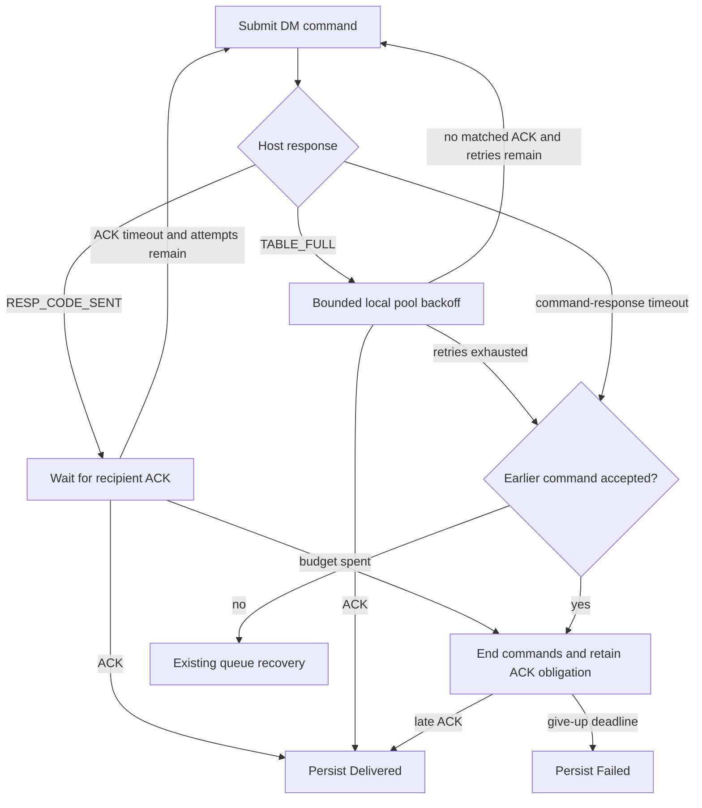

# Messaging Guide

This guide covers the message lifecycle, delivery states, retry logic, and ACK handling in MeshCore One.

## Message Lifecycle

```
┌──────────────────────────────────────────────────────┐
│                        COMPOSE                       │
│  User types message in ChatConversationView            │
└──────────────────────────────────────────────────────┘
                            │
                            ▼
┌──────────────────────────────────────────────────────┐
│                         QUEUE                        │
│  MessageService.sendMessageWithRetry() called        │
│  • Message saved to SwiftData with status: .pending  │
│  • onMessageCreated callback notifies UI             │
└──────────────────────────────────────────────────────┘
                            │
                            ▼
┌──────────────────────────────────────────────────────┐
│                         SEND                         │
│  MessageService.sendMessageWithRetry() runs the      │
│  app-layer retry loop (sendDirectMessageWithRetryLoop)│
│  • Default: 4 on the current out path, then 4        │
│    after one resetPath (counter 1/7 through 7/7)     │
│  • The radio chooses the route on every send         │
│  • A queued send waits while the previous DM can     │
│    still receive a late ACK                          │
│  • Message status: .sent, then .retrying per retry   │
└──────────────────────────────────────────────────────┘
                            │
              ┌─────────────┴─────────────┐
              ▼                           ▼
┌─────────────────────────┐   ┌────────────────────────┐
│     ACK RECEIVED        │   │     SEND PASS ENDED    │
│                         │   │    WITHOUT AN ACK      │
│  • Status: .delivered   │   │                        │
│  • RTT recorded         │   │  • .sent, then .failed │
│  • UI updated           │   │  • User can retry      │
└─────────────────────────┘   └────────────────────────┘
```

## Delivery States

| State | Description | UI Display |
|-------|-------------|------------|
| `.pending` | Saved locally, waiting to send | "Sending..." text |
| `.sending` | Transmission in progress | "Sending..." text |
| `.sent` (DM) | Radio queued the packet, awaiting end-to-end ACK | "Sending..." text (rendered as in-progress so the user never sees a settled "Sent" that later becomes "Failed") |
| `.sent` (channel) | Radio queued the broadcast; no ACK, terminal success | "Sent" text |
| `.delivered` | ACK received from recipient | "Delivered" text |
| `.failed` | No end-to-end ACK by the give-up deadline, or a terminal send failure | "Failed" text + red exclamation icon + red bubble background |
| `.retrying` | Retry in progress | "Retrying %d/%d" text (current attempt / max attempts when `maxRetryAttempts > 0`, falling back to "Retrying..." when `maxRetryAttempts == 0`) + spinner |

**Note:** The retry button only appears for messages with `.failed` status. During `.retrying`, the button is replaced with a spinner to indicate the retry is in progress.

## Retry Logic

### Automatic Retry (sendMessageWithRetry)

**Files:** `MC1Services/Sources/MC1Services/Services/MessageService+DMRetry.swift` owns the retry loop; `MessageService+SendDM.swift` owns send entry and finalization. Attempt counts live in `DMSendBudget.swift`, timing in `MessageServiceConfig.swift`.

A DM loop reads `DMSendBudget` once. The default is 4 attempts on the contact's current out path, then one `resetPath` and 4 fallback attempts. The bubble counter runs `1/7` through `7/7`. Setting Flood Fallback Attempts to zero leaves only the initial attempts and skips `resetPath`. The radio chooses Direct or Flood on every send. Initial attempts can use Flood when the contact has no out path, and later attempts can use Direct if the radio learns an out path after `resetPath`.

`DMSendBudget` bounds initial attempts to 1...4 and fallback attempts to 0...4. Its total is the sum of those counts. Room posts use fixed limits owned by `RoomServerService`: 4 initial attempts and 1 fallback attempt, independent of the DM preference.

`MessageServiceConfig` controls timing:

- `floodFallbackOnRetry: true` - Currently unused; no send/retry code reads it
- `minTimeout: 0` - Minimum timeout seconds. DM loops still read this from `config`
- `triggerPathDiscoveryAfterFlood: true` - Currently unused; no send/retry code reads it
- `ackGiveUpWindow: 30` - Floor and post-loop grace for the give-up deadline

Room posts share plain-text send admission with DMs. After admission, the app checks that the post still exists and the room still allows posting. Within a connection, distinct posts to the same room get increasing whole-second wire timestamps. Automatic retries reuse the post's wire timestamp.

```
Attempts 1-4: contact's current out path
    │
    ▼ Timeout, no ACK, Flood Fallback Attempts > 0
resetPath, then attempts 5-8
    │
    ▼ Timeout, no ACK
Stays .sent until the ACK window ends
```

### Command Failure After Acceptance

`RESP_CODE_SENT` means the radio accepted a DM command for transmission. It does not mean the recipient received the packet. After at least one command in a pass is accepted, exhausted local `TABLE_FULL` backoff or a missing host command response ends command issuance for that pass. The original message retains its ACK obligation and reaches `.delivered` on an eligible ACK or `.failed` at its give-up deadline. The queue does not restart that accepted prefix at attempt zero on the same link.

An explicit `TABLE_FULL` rejection retains earlier accepted ACK codes and their deadline. Waiting through local backoff does not extend that deadline. A command-response timeout has an uncertain send outcome, so tracking also retains that command's predicted ACK and a window that covers the preceding accepted deadline. Firmware ACK codes repeat every four attempts: rejecting attempt 5 must preserve the code already accepted for attempt 1.

An ACK during local pool backoff stops further command submissions. The current command, if one is in flight, still owns its completion before the next sender can be admitted. A recipient ACK timeout alone continues through the configured attempt budget.

Failures before any command is accepted retain the existing queue recovery policy. Genuine cancellation, session retirement, and transport loss retain reconnect replay with the original wire timestamp. Those recovery paths are separate from ending a partially accepted pass on the same link.



### Direct vs Flood Routing

**Direct Routing:**
- Uses the contact's known `outPath` (routing nodes)
- More efficient, fewer radio transmissions
- Fails if path is stale or nodes are unreachable

**Flood Routing:**
- Broadcasts to all nearby nodes
- Message propagates through entire mesh
- More likely to succeed but uses more bandwidth
- Indicated by `outPathLength < 0` (-1)

### Path Reset During Retry

When Flood Fallback Attempts is greater than 0, the loop calls `resetPath` once before the fallback attempts:

```swift
try await session.resetPath(publicKey: contact.publicKey)
```

This clears the contact's cached out path. The radio chooses the route for every later send.

### Automatic vs Manual Retry

**Automatic Retry:**
- Initiated by `sendMessageWithRetry()` when first sending a message
- The retry loop runs at the app layer in `sendDirectMessageWithRetryLoop`, not inside `MeshCoreSession`, so each attempt can emit UI feedback
- After the first attempt fails, status moves to `.retrying` and a `.retrying` event is broadcast per subsequent attempt
- No user interaction required
- If the budget is spent with no ACK, or a later command fails after prior acceptance, command issuance ends and ACK tracking owns the remaining delivery outcome

**Manual Retry:**
- Triggered when user taps "Retry" button on a failed message
- The UI's `retryMessage` replaces the `PendingSend` row (`replacePendingSendForRetry`), sets status to `.pending`, and signals the persistent send queue; it does not set `.retrying` immediately
- The queue drain later runs the same retry loop as an automatic send. It reads `DMSendBudget` once after admission, so a picker change while the row is waiting applies to that loop. `.retrying` is only set by the loop after the first attempt fails. The row stays `.pending` with no counter until it is admitted, including while an earlier DM can still receive a late ACK
- Retry button disappears while `.retrying` status is active

### Manual Retry Details

When a user taps "Retry" on a failed message, `ChatViewModel.retryMessage` replaces the persisted `PendingSend` row, sets the status to `.pending`, and signals the send queue:

```swift
_ = try await dataStore.replacePendingSendForRetry(messageID: message.id, dto: dto)

coordinator?.applyStatusUpdate(
    messageID: message.id,
    status: .pending,
    userInitiated: true
)

try await signalDMEnqueued(envelope)
```

The queue drain calls `performQueuedDirectMessageSend`, which runs `sendDirectMessageWithRetryLoop`. That loop marks `.retrying` via `updateMessageRetryStatus` only after the first attempt fails. With the default budget it sends 4 attempts on the current out path, calls `resetPath` once, then sends 4 fallback attempts. The radio chooses the route on every send. The same code path serves automatic and manual retries. A queued send waits while the previous plain-text send can still receive a late ACK.

The UI shows:
- "Retrying %d/%d" text (current attempt / max attempts) with a spinner icon when `maxRetryAttempts > 0`, falling back to plain "Retrying..." only when `maxRetryAttempts == 0`
- The retry button is hidden while in `.retrying` status

## ACK Tracking

### PendingAck Structure

`MessageService` keeps one `PendingAck` per message ID. Each entry holds the eligible ACK codes, send time, timeout, and optional `PendingSend` owner. The persistent listener (`startEventMonitoring`) subscribes via `session.events(filter: .anyAcknowledgement)`. A late ACK from an earlier accepted attempt can still resolve the message.

On reconnect, unexpired ACK owners recovered from `PendingSend` hold admission before the queue hydrates. Each reservation ends when its ACK is resolved or its deadline expires.

At the end of an accepted send pass, the owner on `PendingAck` records the row ID, radio ID, deadline, and whether persistence needs to insert a row or convert the original queued `PendingSend`. If the write fails, the ACK checker uses the same owner and tracked ACK codes and send time for the next save. A successful write advances the owner to its saved phase. A recorded ACK or elapsed deadline then resolves the message and consumes that row. Row identity and terminal-state guards protect a later user retry from stale completion. The ACK checker also retries terminal writes for saved owners.

Quick replies and DM reactions persist their single-attempt policy before waiting for admission. Recovery sends them once even when the configured DM budget allows more attempts. The attempt count is saved before the command, so recovery preserves the wire timestamp if transmission may have started. Delivered or failed inline sends are removed from the queue without another send.

### ACK Flow

```
Predict the ACK code and start tracking before command submission
    ├─ ACK matched during issuance → resolve delivery
    └─ Accepted pass ends with ACK tracking active → save PendingAck owner
        ├─ Save fails → ACK checker retries the owner write
        └─ Save succeeds → resolve delivery on a matching ACK, or fail at the deadline
```

An end-to-end ACK that arrives after its `PendingAck` entry is gone (failed and removed, or duplicate) has no live entry to match; `handleAcknowledgement` logs it as an unmatched ACK and returns without changing status.

**ACK Timeout:**
The per-attempt ACK wait used by the retry loop is `retryAckTimeoutMultiplier` (1.2x) of the device-suggested timeout to provide a safety margin:

```swift
// From MeshCoreSession+Messaging.swift
let ackTimeout = timeout ?? (
    Double(sentInfo.suggestedTimeoutMs) / SessionConfiguration.millisecondsPerSecond
        * SessionConfiguration.retryAckTimeoutMultiplier
)
```

### ACK Expiry Checking

Started on connect via `startAckExpiryChecking(interval:)` (defaults to every 5 seconds) and torn down on disconnect via `stopAndFailAllPending`, which cancels the periodic task and writes `.failed` for any remaining in-flight rows. A routine disconnect instead uses `stopAckExpiryChecking()`, leaving in-flight DMs `.sent` so a reconnect within the same session can still receive their ACKs.

```swift
ackCheckTask = Task { [weak self] in
    guard let self else { return }

    while !Task.isCancelled {
        do {
            try await Task.sleep(for: .seconds(self.checkInterval))
        } catch {
            break
        }

        guard !Task.isCancelled else { break }

        do {
            try await self.checkExpiredAcks()
        } catch {
            self.logger.error("ACK expiry check failed: \(error.localizedDescription)")
        }
    }
}
```

**checkExpiredAcks:**
- Finds undelivered ACKs where `now - sentAt > max(ackGiveUpWindow, PendingAck.timeout)`
- Marks corresponding messages as `.failed` (via `updateMessageStatusUnlessDelivered`, which leaves an already-`.delivered` row untouched)
- Removes the matching `PendingAck` entry and broadcasts `.failed`

### Repeat ACKs

Heard-repeat tracking lives on `HeardRepeatsService` + the `MessageRepeat` model, not on `PendingAck` — duplicate ACKs are recorded there and surfaced via the `heardRepeats` count on `MessageDTO`.

## Message Deduplication

**File:** `MC1Services/Sources/MC1Services/Utilities/DeduplicationKey.swift`

Messages carry an optional `deduplicationKey: String?` field (stored on `Message`) to prevent duplicate incoming messages from being stored. The key is generated by `DeduplicationKey.contentBased`, the single source of truth used by live sync (`SyncCoordinator`), on-device backfill migration, and backup export/import. The format differs for channel vs direct messages, combining the conversation scope, timestamp, and a hash of the message content:

```swift
// DeduplicationKey.contentBased(...)
static func contentBased(
    contactID: UUID?,
    channelIndex: UInt8?,
    senderNodeName: String?,
    timestamp: UInt32,
    content: String
) -> String {
    let contentHash = SHA256.hash(data: Data(content.utf8))
    let hashPrefix = contentHash.prefix(4).map { String(format: "%02X", $0) }.joined()
    if let channelIndex {
        return "\(channelPrefix)\(channelIndex)-\(timestamp)-\(senderNodeName ?? "")-\(hashPrefix)"
    }
    let contactSegment = contactID?.uuidString ?? unknownContactPlaceholder
    return "\(directMessagePrefix)\(contactSegment)-\(timestamp)-\(hashPrefix)"
}

// Channel example: "ch-3-1703123456-Alice-8F3A9B2C"
// Direct example:  "dm-<contactUUID>-1703123456-8F3A9B2C"
```

**Components:**
- **Scope prefix**: `ch-<channelIndex>` for channel messages, `dm-<contactID>` for direct messages (`unknown` when the contact is unresolved)
- **Sender node name**: included for channel messages (parsed from the `"Name: text"` channel payload), empty when absent
- **Timestamp**: Message timestamp (UInt32)
- **Content Hash**: First 4 bytes of SHA256 hash of message content, uppercase hex

When a message is received, the system checks if a message with the same deduplication key already exists (`fetchMessage(deduplicationKey:radioID:)`). If found, the duplicate **message** is not stored again. A later flood copy whose `pathNodes` differ from the canonical path is recorded as a `MessageRepeat` extra arrival (`recordDistinctPathIfNeeded`). Extra `PUSH_CODE_LOG_RX_DATA` (0x88) rows that arrived before the first `saveMessage` are harvested afterward (`harvestIncomingPaths`): the coordinator re-decrypts those rows (`decryptEntry`) and `ChannelRXCorrelation` joins them to the saved message by `DeduplicationKey`, not stamp alone. This keeps one timeline bubble while preserving every distinct path. The first incoming path stays on `Message.pathNodes`; extra incoming paths do not change outgoing every-echo repeats.

The SHA256 hash ensures that:
- Identical messages in the same conversation at the same timestamp are deduplicated
- Different messages at the same timestamp are stored separately
- The key is stable across app restarts

## Channel vs Direct Messaging

### Direct Messages

- Sent to a specific contact's public key (6-byte prefix)
- Encrypted end-to-end
- Support ACK/delivery confirmation
- Include deduplication key to prevent duplicates
- Use `sendMessageWithRetry()` or `sendDirectMessage()`

### Channel Messages

- Broadcast to a channel slot (0..<(device.maxChannels))
- Encrypted with shared channel secret (SHA-256 of passphrase)
- No end-to-end ACK. `.sent` means the radio accepted `03` with `RES_CODE_OK` (queued for TX)
- Use `sendChannelMessage()`. A `ResolvedFloodScope` on that send is temporary: a 16-byte named key or `36 01` is restored with zero-key `36 00` before the next app command. A zero key is the baseline and has no trailing reset. `setFloodScope` stays sticky
- `ChannelFloodScopeResolver` resolves transmission preferences. Inheritance selects the radio's persisted default; the channel header uses the cached default name only for display
- An accepted `03` stays `.sent` if cleanup fails. The session fences further messaging commands while the connection owner arranges replacement. Retirement joins the Sent write for queued sends and inline quick replies before the conversation reloads

```swift
// Channel message format: "NodeName: message text"
let text = "\(deviceName): \(userText)"
try await session.sendChannelMessage(channel: channelIndex, text: text)
```

## MessageEventDispatcher Integration

**File:** `MC1/State/MessageEventDispatcher.swift`

The dispatcher bridges per-service event streams to SwiftUI via `MessageEventStream`. `MessageService` exposes its outbound-message lifecycle as an `AsyncStream<MessageStatusEvent>` (`statusEvents()`); the dispatcher consumes it and forwards `MessageEvent` cases into the stream:

```swift
private func wireMessageService(_ messageService: MessageService) {
    let events = messageService.statusEvents()
    let task = Task { [stream] in
        for await event in events {
            switch event {
            case .statusResolved(let messageID, let status, let roundTripTime):
                stream.send(.messageStatusResolved(messageID: messageID, status: status, roundTripTime: roundTripTime))
            case .resent(let messageID):
                stream.send(.messageResent(messageID: messageID))
            case .retrying(let messageID, let attempt, let maxAttempts):
                stream.send(.messageRetrying(messageID: messageID, attempt: attempt, maxAttempts: maxAttempts))
            case .routingChanged(let contactID, let isFlood):
                stream.send(.routingChanged(contactID: contactID, isFlood: isFlood))
            case .failed(let messageID):
                stream.send(.messageFailed(messageID: messageID))
            }
        }
    }
    tasks.append(task)
}
```

### Event Types

`MessageEvent` (`MC1/State/MessageEvent.swift`):

| Event | Trigger |
|-------|---------|
| `.directMessageReceived` | New incoming direct message |
| `.channelMessageReceived` | New incoming channel message |
| `.roomMessageReceived` | New incoming room message |
| `.messageStatusResolved` | Outgoing message resolved (ACK delivered / failed) |
| `.messageResent` | Outgoing message resent |
| `.messageFailed` | Message delivery failed |
| `.messageRetrying` | Retry in progress |
| `.heardRepeatRecorded` | Heard repeat count updated |
| `.reactionReceived` | Reaction summary updated for a message |
| `.routingChanged` | Contact switched to/from flood routing |
| `.roomMessageStatusUpdated` | Room message status updated |
| `.roomMessageFailed` | Room message delivery failed |

## Message Polling

**File:** `MC1Services/Sources/MC1Services/Services/MessagePollingService.swift`

Messages are pulled from the device queue:

```swift
// Triggered by MeshCore notification
func pollAllMessages() async throws -> Int {
    while true {
        let result = try await pollMessage()

        if case .noMoreMessages = result {
            return count  // Queue empty
        }

        // Process message...
    }
}
```

### Auto-Fetching

When enabled, messages are automatically fetched on BLE notification:

```swift
await session.startAutoMessageFetching()
```

The session monitors the notification characteristic and calls `getMessage()` when data arrives.

## Reactions

Reactions are sent as special message payloads and rendered as badges below messages. See the
[Reactions Interoperability Guide](../Reactions.md) for the wire format and hashing rules.

## See Also

- [MessageService API](../api/MC1Services.md#messageservice-public-actor)
- [Architecture Overview](../Architecture.md)
- [BLE Transport Guide](BLE_Transport.md)
